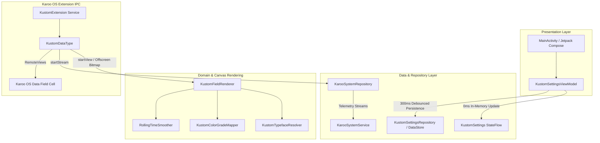
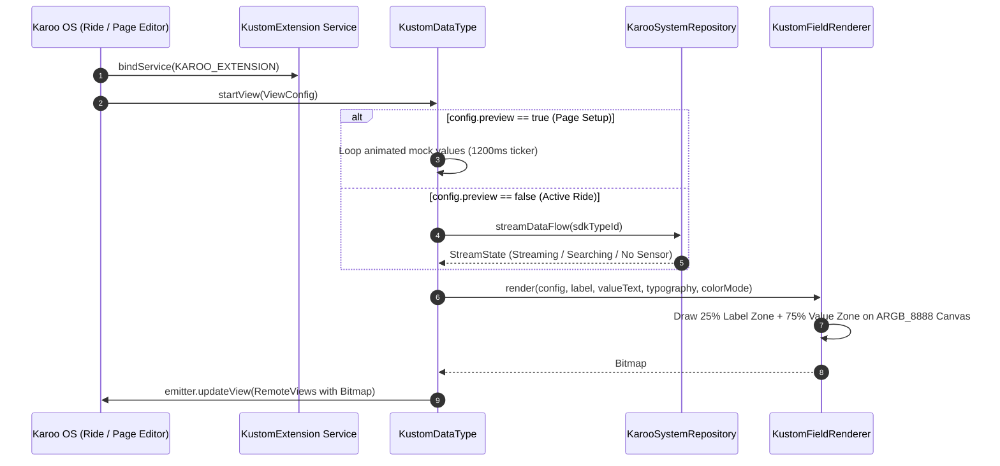

# Kustom - Advanced Custom Data Fields Extension for Hammerhead Karoo

[](https://hammerhead.io)
[](https://hammerheadnav.github.io/karoo-ext/)
[](https://kotlinlang.org/)

**Kustom** is a native Karoo Extension (`io.hammerhead.karooext`) designed for Hammerhead Karoo 2 and Karoo 3 bike computers. It allows cyclists to design, customize, and display high-legibility telemetry fields with dynamic font scaling, custom typography (Karoo RBNo2.1a, Wahoo Barlow, Garmin DIN, Athletic Teko, Clean Roboto), rolling time-window smoothing (3s, 5s, 10s, 30s), and real-time zone color formatting.

---

## 🏛️ Architectural Overview

The Kustom extension follows **Android Clean Architecture** principles, cleanly separating UI presentation, domain canvas rendering, local settings persistence, and Karoo OS IPC telemetry streaming.

```
┌─────────────────────────────────────────────────────────────────────────────┐
│                          PRESENTATION LAYER (UI)                            │
│  MainActivity.kt + Jetpack Compose (KustomKarooNativeScreen, GlobalFonts)   │
└──────────────────────────────────────┬──────────────────────────────────────┘
                                       │
                                       ▼
┌─────────────────────────────────────────────────────────────────────────────┐
│                         VIEWMODEL & DATA LAYER                              │
│  KustomSettingsViewModel ◄──► KustomSettingsRepository (Preferences DataStore)
└──────────────────────────────────────┬──────────────────────────────────────┘
                                       │
                                       ▼
┌─────────────────────────────────────────────────────────────────────────────┐
│                        DOMAIN & RENDERING ENGINE                            │
│  KustomFieldRenderer ◄──► KustomTypefaceResolver ◄──► KustomColorGradeMapper │
└──────────────────────────────────────┬──────────────────────────────────────┘
                                       │
                                       ▼
┌─────────────────────────────────────────────────────────────────────────────┐
│                     KAROO EXTENSION IPC SERVICE                             │
│  KustomExtension (KarooExtension) ──► KustomDataType (DataTypeImpl)         │
│  ◄──► KarooSystemService (Telemetry Streams: Power, HR, Speed, Elevation)   │
└─────────────────────────────────────────────────────────────────────────────┘
```

---

## 📊 System Architecture & Data Flow Diagrams

### Component Architecture



### Telemetry Streaming & Offscreen Rendering Sequence



---

## 📂 Project Structure Walkthrough

```
app/src/main/
├── java/com/hank/kustom/
│   ├── data/
│   │   ├── model/
│   │   │   ├── ColorMode.kt           # Zone formatting color modes (NONE, BACKGROUND, TEXT)
│   │   │   ├── FieldCategory.kt       # Parent telemetry categories (Power, Speed, HR, Climb, Time...)
│   │   │   ├── GlobalTypographyConfig.kt # Global typography configuration model
│   │   │   ├── KustomFieldCatalog.kt  # Complete 54-field matrix definitions and SDK type mappings
│   │   │   ├── KustomFieldConfig.kt   # Per-field smoothing and zone color configurations
│   │   │   ├── KustomFont.kt          # Top 5 cycling fonts (Karoo, Wahoo, Garmin, Teko, Roboto)
│   │   │   ├── KustomSettings.kt      # Root application settings state
│   │   │   ├── SmoothingOption.kt     # Rolling average duration options (0s, 3s, 5s, 10s, 30s)
│   │   │   └── ZoneFormat.kt          # Segmented pill option choices (None, Text, Fill)
│   │   └── repository/
│   │       ├── KarooSystemRepository.kt   # Reactive flow wrapper for KarooSystemService
│   │       └── KustomSettingsRepository.kt # Asynchronous Preferences DataStore persistence
│   ├── domain/
│   │   ├── KustomColorAndSmoothing.kt # Power/HR/Grade zone color mappers & RollingTimeSmoother
│   │   ├── KustomFieldRenderer.kt    # Offscreen ARGB_8888 canvas renderer (25% top / 75% bottom)
│   │   └── KustomTypefaceResolver.kt # Typeface loader & font weight application
│   ├── extension/
│   │   ├── KustomExtension.kt        # Primary KarooExtension service entry point
│   │   └── types/
│   │       └── KustomDataType.kt     # Concrete DataTypeImpl handling IPC views and streams
│   ├── ui/
│   │   ├── KustomSettingsViewModel.kt# ViewModel with 0ms in-memory state & debounced persistence
│   │   └── MainActivity.kt           # Configuration UI activity with adaptive Light/Dark theme
│   └── util/
│       └── KustomLogger.kt           # Logcat buffer and disk crash log persistence
└── res/
    ├── drawable/
    │   ├── ic_kustom_field.xml       # Vector logo & icon asset
    │   ├── ic_launcher_background.xml# Launcher background asset
    │   └── ic_launcher_foreground.xml# Launcher foreground asset
    ├── values/
    │   └── strings.xml               # App string resources & "CATEGORY: FIELD" page setup titles
    └── xml/
        └── extension_info.xml        # Karoo OS metadata manifest declaring all extension data types
```

---

## 🛠️ Developer Guide: Learning & Maintaining Kustom

### 1. Prerequisites & Environment
- **Android Studio**: Android Studio Ladybug or newer.
- **JDK**: Java 17+.
- **Android SDK**: API Level 34+ (Build-Tools 35.0.0).
- **Target Device**: Hammerhead Karoo 2 or Karoo 3 unit connected via USB (or Karoo Emulator).

### 2. How to Build & Install
Run the Gradle assemble task and deploy to your connected device:

```bash
# Build Debug APK
./gradlew app:assembleDebug

# Deploy to connected Karoo unit
adb -s <device_serial> install -r app/build/outputs/apk/debug/app-debug.apk

# Launch MainActivity Settings
adb -s <device_serial> shell am start -n com.hank.kustom/.ui.MainActivity
```

### 3. Adding a New Data Field to Kustom
To add a new telemetry field (e.g. `TORQUE`):

1. **Add Field Definition to `KustomFieldCatalog.kt`**:
   ```kotlin
   val TORQUE = KustomFieldDefinition(
       typeId = "torque",
       childTitle = "Torque",
       category = FieldCategory.POWER,
       description = "Current torque output",
       supportsSmoothing = true,
       supportsZones = true,
       mockValues = listOf(18.0, 22.0, 25.0, 28.0, 24.0)
   )
   ```
2. **Add String Resources to `res/values/strings.xml`**:
   ```xml
   <string name="field_torque_name">POWER: TORQUE</string>
   <string name="field_torque_desc">Current torque output</string>
   ```
3. **Register Metadata in `res/xml/extension_info.xml`**:
   ```xml
   <DataType
       typeId="torque"
       displayName="@string/field_torque_name"
       description="@string/field_torque_desc"
       graphical="true"
       icon="@drawable/ic_kustom_field" />
   ```
4. **Map SDK Constant in `KustomFieldDefinition.resolveSdkDataTypeId`**:
   ```kotlin
   "torque" -> DataType.Type.TORQUE
   ```

---

## 🔍 Debugging & Log Inspection

Kustom includes an in-memory logcat buffer and an uncaught exception file persistence handler (`kustom_crash.log`).

- **View Live Logs**: Click the **`Logs 📋`** button in `MainActivity` top navigation bar to open the system and crash log dialog.
- **ADB Logcat**: Filter logcat using tag `Kustom`:
  ```bash
  adb logcat -s Kustom
  ```
- **Inspect Service Binding**:
  ```bash
  adb shell dumpsys package com.hank.kustom
  ```

---

## 📜 License & Copyright

Copyright © 2026 Kustom. All rights reserved. Built with the official [Hammerhead Karoo Extension SDK](https://github.com/hammerheadnav/karoo-ext).
